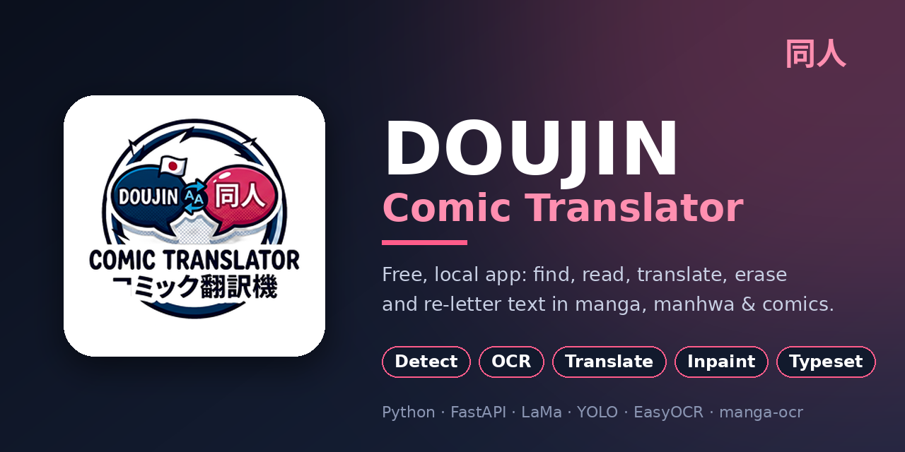
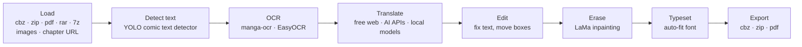

<div align="center">



# Doujin Comic Translator

**A free, local app that finds, reads, translates, erases and re-letters the text in manga, manhwa, webtoons and comics.**

*Manga translator · manhwa & webtoon translator · comic translator: text detection, OCR, AI translation, text removal (inpainting) and typesetting in one app, with free web translators, AI APIs (OpenRouter, Gemini, DeepL…) and local models.*


</div>

> 🌱 **A beginner's vibe-coding project.** I'm not a professional developer: this was built by describing what I wanted to an AI assistant (Claude), testing it, and asking for fixes. It's experimental, so expect rough edges. [Read the story →](docs/vibe-coding-notes.md)

## ✨ What it does

Load a chapter, press a few buttons, and get a translated copy back.



## 🚀 Features

- **Many inputs and outputs:** cbz, zip, cbr, rar, 7z, pdf, images, or paste a chapter link.
- **Step-by-step buttons** so you stay in control: Analyze → OCR → Translate → Edit → Inpaint → Export.
- **Smart erasing:** glyph-accurate masks, flat bubbles get a clean colour fill, everything else goes to LaMa on small patches.
- **Auto font fitting** that finds the biggest size that fits the bubble.
- **Lots of translators, free first:**
  - *Free web translators* (no key): Google, Bing, Papago, Mirai, Youdao, MyMemory, Reverso, iTranslate, Yandex and more, with automatic fail-over.
  - *AI / API* (your own keys): OpenRouter free models, Gemini, Groq, Mistral, Cerebras, DeepL, OpenAI, Claude, Kimi, Perplexity, Ollama, LM Studio, or any OpenAI-compatible server.
  - *Local models:* Opus-MT, NLLB, Qwen2.5 / Qwen3, Qwen2.5-VL.
- **Hand editing:** drag and resize boxes, fix text, change font, size and colour per box.
- **Safety net:** AI refusals or explanations are caught and never printed onto your page.
- **Works offline-capable:** local OCR, inpainting and translation models (Opus-MT, NLLB, Qwen via Ollama / LM Studio), so pages never have to leave your PC.
- **Standalone Windows app:** build a `DoujinTranslator.exe` with one script.

## 📦 Quick start (Windows)

1. Install [Python 3.12](https://www.python.org/downloads/) and (optional, for rar / 7z) [7-Zip](https://www.7-zip.org/).
2. Download this repo (green **Code** button → *Download ZIP*) and unzip it.
3. Double-click **`run.bat`**. The first run sets everything up (this takes a while and downloads models).
4. The app opens in its own window. Use **Import** on the left to load a chapter.

From the command line:

```bash
python -m venv venv
venv\Scripts\activate
pip install torch torchvision
pip install -r requirements.txt
python launcher.py
```

An NVIDIA GPU is optional but makes OCR, inpainting and local models much faster.

### Make your own `.exe`

```bash
build_exe.bat
```

Result: `dist\DoujinTranslator\DoujinTranslator.exe`. Details and tips are in [docs/TECHNICAL.md](docs/TECHNICAL.md).

## 🧰 Built with

| Job | Tool |
|---|---|
| App / server | FastAPI + a plain HTML/JS interface |
| Text detection | YOLOv8 comic text segmenter (Ultralytics), EasyOCR as fallback |
| OCR | manga-ocr (Japanese), EasyOCR (Korean, Chinese, Spanish, English) |
| Erasing text | LaMa inpainting + OpenCV |
| Translation | Free web translators, AI APIs, Opus-MT / NLLB / Qwen |
| Packaging | PyInstaller |

## 🗂️ Project layout

```
launcher.py      starts the app and opens its window (entry point of the .exe)
app.py           web server and API routes
pipeline.py      detect, OCR, translate, erase, typeset, export
providers.py     AI / API translator providers
paths.py         where files live (source vs .exe)
static/          the web interface and logo
docs/            notes and technical details
doujin.spec      PyInstaller recipe     build_exe.bat   one-click build
```

## ⚠️ Status and honest notes

- **Experimental.** The erasing and fitting code was tested on synthetic pages, the URL loader against a fake site, and the interface in a simulated browser. Real models on real pages, the free web translators, and the `.exe` build still need more testing.
- Free web translators can be blocked, and free AI tiers change their limits without warning.
- Sites behind Cloudflare or a login can't be downloaded from a link. Save the chapter in your browser and load the folder or cbz.
- Machine translation makes mistakes. Always read the result.

## 🗺️ Roadmap

- [ ] Optional online / remote inpainting backend
- [ ] Vertical text layout
- [ ] Send the bubble image to vision models for better translations
- [ ] Screenshots and a short demo video
- [ ] More tests

## ⚖️ Responsible use and licenses

- **Only use this on comics you own or have the right to translate.** The repo contains no comic pages. Please respect creators and the terms of the sites you download from.
- This project's code is [MIT](LICENSE). The libraries and models it uses have their own licenses: for example, Ultralytics YOLO is **AGPL-3.0**, which matters if you distribute a built `.exe`. Check each project before redistributing. This isn't legal advice.

## 🙏 Credits

Inspired by and learned from [comic-translate](https://github.com/ogkalu2/comic-translate) (its erasing and font-fitting approach), and built on [LaMa](https://github.com/advimman/lama), [manga-ocr](https://github.com/kha-white/manga-ocr), [EasyOCR](https://github.com/JaidedAI/EasyOCR), [Ultralytics](https://github.com/ultralytics/ultralytics), [FastAPI](https://fastapi.tiangolo.com/) and many free translation services. Thank you to all of them.

---

<sub>**Keywords:** manga translator, manhwa translator, webtoon translator, comic translator, doujin translator, manga OCR, manga-ocr, text detection, text removal, image translation, inpainting, LaMa, YOLO, EasyOCR, typesetting, cbz, OpenRouter, Gemini, DeepL, Ollama, FastAPI, Windows, local AI, vibe coding.</sub>

<div align="center">Made with curiosity and a lot of chatting with an AI 💬</div>
